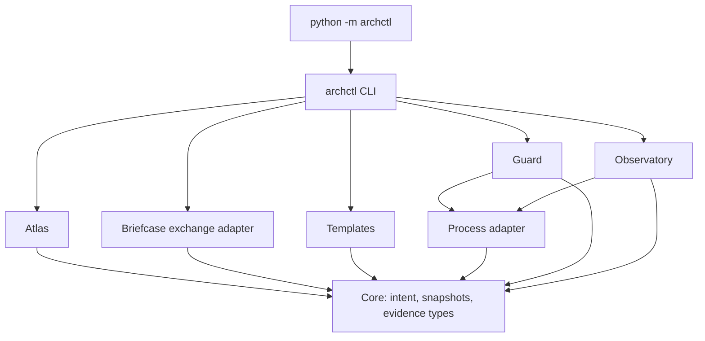

# Architecture Control Plane

## Context-first workflow

The default agent integration supplies architectural context and durable reasons.
`cli_context.py` composes Core, Atlas and external integrations without requiring
governed adoption. Core owns attributable immutable memory and optional identity
overrides. Atlas builds an advisory packet from task scope, reasons, source
candidates and normalized evidence; it never executes commands. Integrations
own the shared bounded executor and source-scoped execution records.

Memory origins (`observed`, `user_stated`, `agent_inferred`, `agent_chosen`)
remain separate from source observations and optional declared intent. Records
preserve original references, assumptions and supersession/conflict links; an
agent interpretation is never silently promoted to a user decision. Retrieval
uses task words, path/component scope and graph relationships. Semantic judgment
stays with the coding agent. No new analyzer, graph database or LLM service is added.

Provisional path bindings can be overridden in `architecture/context.yaml` with
stable IDs and aliases. This file is excluded from governed authoring snapshots.
The context packet can include partial evidence and stale reasoning without
becoming a passing architecture claim. Actual command outcomes and applicability
to current inputs remain separate. Commands come from the agent's explicit task
execution, never from a retrieved suggestion. Source identity is scoped, not an
attestation of external dependencies or a production deployment.

Advisory contracts live in `contracts/context/v1/`. The existing v2 workflow below
remains available when reviewed architectural acceptance is explicitly selected.
Its baseline trust and execution prerequisites apply only to governed commands.
See ADR-005 and [the context guide](docs/context.md).

## Boundaries

This is one package with a typed shared core and independent feature modules. It is intentionally local: the application's architecture and evidence files live in its repository; the tool does not maintain a second graph database.

Core never imports a feature module. Atlas does not execute tests or approve decisions. Guard never imports Atlas; the CLI hands it a freshly built impact contract. Observatory never imports Guard. Templates depends only on Core. The entrypoint invokes CLI and no other feature module. Shared process execution lives in `integrations/process.py`. The compiled model declares the prohibited directions; a model-driven dependency test rejects violations and cycles.

The root `archctl/__init__.py` is its own package component and a shared bootstrap surface. Every component that imports a submodule also imports the package root, so the model declares those eight component-to-package relationships (ADR-004). They are structural, not feature dependencies, and they do not relax the independence rules above. An import inside one component is not a relationship between components: reconciliation reports it as an ignored intra-component observation and never as undeclared drift. A declared relationship must connect two different components.

## Shared types and ownership

`Model` represents intended architecture. `Snapshot` pins that model and all authoring inputs. `Observations` represents externally supplied evidence with a separate source identity. These types are frozen dataclasses with immutable nested collections. They are never merged into an authoritative graph.

The compiler reads authoring files once, checks IDs, references, policy contradictions and decision lifecycle, then sorts named entities and hashes canonical JSON. The snapshot digest includes the rationale body and raw authoring-file hashes, but excludes timestamps and absolute filesystem paths. It is reproducible after moving the repository.

`read_snapshot` verifies structural validity and recomputes the digest. This detects accidental or unreconciled edits. It does not authenticate a reviewer; anyone able to replace the trusted baseline can replace its digest too.

## Change Contract and composite local gate

`core/change.py` owns immutable `Change` and `Acceptance` task data. A Change
Contract records reviewed task interpretation; it is not enduring architecture
authority. `atlas/change_scope.py` validates actual and affected scope and adds
existing verification obligations. It cannot define new executable commands.

`cli_gate.py` and `cli_report.py` belong to the CLI component and compose the
existing feature modules. A fresh Python process imports the selected evaluator
before compiling intent, mapping evidence, calculating impact, checking scope,
reconciling drift, running Guard and building the summary. Each invocation uses
a new `.archctl/runs/run-*` directory. No previous verdict or evidence artifact
is reused from another run. Evidence explicitly supplied or found at the default
input path is copied into the run and its pins are rechecked.

The local result combines evidence, Guard, relevant drift and acceptance checks.
Optional missing relationships and unrelated drift remain informational. The
low-level Guard report retains its narrower semantics; it is not the composite
feature-completion verdict. An audit without a Change Contract makes no
acceptance claim. Task contracts and changed-path inventories are rechecked
after verification, alongside existing source and authoring pins.

## Task data flow

0. Run `archctl status` to confirm that the model and evidence are coherent. `ready` is a readiness result, not an approval or a passing gate.
1. Select the reviewed baseline SHA and evaluator, compile baseline and candidate intent, and read the task contract.
2. Import normalized evidence; verify references, source hashes and component file inventories.
3. Map changed/planned paths to components. Walk observed consumers in reverse and expand declared interface consumers and workflow participants to a fixed point.
4. Link active decisions and collect verification requirements from policies, interfaces and workflows.
5. Reconcile relevant drift. Guard evaluates applicable forbidden edges and required relationships. It combines those outcomes with change-specific unknowns and architecture approval status.
6. If explicitly requested and all prerequisite gates pass, execute the declared verification commands. Recheck source and authoring pins before/after execution.
7. Recheck inputs and emit one versioned local result with actual acceptance outcomes and detailed artifacts. Atlas does not rewrite approved intent.

Impact expansion is deliberately conservative. A supported edge makes another component a candidate consumer, not proof of a behavioral change. Static absence is meaningful only inside the exporter's explicit complete scope. Path mapping, workflows and interface declarations supply architectural semantics that raw imports cannot supply.

## Authority boundary

The local gate baseline is a full Git commit SHA selected after operator review. A pinned installation outside application source supplies the evaluator; self-checks use the baseline tool checkout. Guard compares the complete normalized model, including decisions, ownership and commands, before running verification. A changed candidate model cannot approve itself by changing its ADR status to `accepted`.

Formatting-only authoring edits change the snapshot's provenance digest but can retain the same normalized model. Such edits do not require semantic authority approval. Rationale text is part of the model; changing it does.

One v2 contract family carries explicit required/advisory obligations. Model
`enforcement: strict` is the default and keeps undeclared in-scope dependencies
blocking. Explicitly reviewed `selective` mode makes those observations advisory;
it uses the same types, schemas and output contracts. Policy severity is display
metadata. Trust, freshness, unresolved scope and global coverage remain required.
Legacy v1 authoring normalizes at the input boundary; snapshots and exchange
outputs are always v2. The explicit migration command writes a new reviewable file.

Approval is external to the tool. The tool emits `unknown` until a reviewer-controlled process establishes a new baseline. It has no `--approve` shortcut and does not write the baseline during a gate. Because Guard compares the whole normalized model, a passing gate implies unchanged authority; the skill uses that to advance a local `archctl-baseline` tag after a pass, and leaves authority changes to the operator.

## Outcomes and trust

| Outcome | Meaning |
|---|---|
| passed / exit 0 | All applicable stages completed and passed within declared scope and coverage |
| failed / exit 1 | A current prohibited/required relationship or required test is demonstrably wrong |
| unknown / exit 2 | Needed evidence, scope, mapping, review or execution is unresolved |
| error / exit 3 | Input, model, reference, baseline or evaluator execution is invalid |

A proven failure takes precedence over unknown. An input error prevents a valid
assessment. Missing optional relationships and unrelated drift are
informational; current relevant coverage and in-scope undeclared relationships
remain blocking. Global coverage gaps stay conservative because the exchange
format does not localize every gap to a component.

The operator reviews intent, verification commands and the baseline the tag
starts from. The tool does not authenticate those decisions. For an ordinary
app, run a reviewed installation outside candidate source. For archctl
self-checks, the baseline must contain the evaluator; no fallback imports the
candidate evaluator. The launcher, evidence producer, runtime dependencies and
filesystem are trusted. Input rechecks detect persistent changes, not malicious
modify-and-restore activity or external side effects.

## Verification scope

Guard and Observatory use one command executor. Commands are reviewed argument vectors, not shell strings. The executor limits each command to 1–300 seconds, bounds returned stdout/stderr to 64 KiB each, and terminates the process group on timeout on POSIX. Full command output is spooled to temporary files, so returned data is bounded; operating-system disk/resource quotas remain the CI runner's responsibility.

The executor is not a security sandbox. A test can execute arbitrary application code. Pin checks before/after execution detect persistent candidate edits, not malicious edits followed by restoration or side effects outside the repository. Evidence exporters and runners are trusted parts of the development environment.

`passed`, `failed`, `not_executed`, and `unknown` remain distinct. A missing executable or timeout is unknown. A nonzero test exit is failed. A test association is not an execution result. A passing command produces no automatic call edges or OpenTelemetry spans.

## Implementation tradeoffs

The implementation uses Python 3.11+ and PyYAML because a Python runtime was available in the implementation environment and a Rust toolchain was not. Frozen data types and import-boundary tests preserve the proposed modular design. The CLI is the first agent integration surface.

Single-repository explicit-path impact and native Briefcase Python import mapping are implemented. Comparison between two pinned graph views, an MCP transport, non-Python Briefcase mapping, hosted approvals and an interactive graph UI are deferred. Runtime exchange import and scenario execution are present; instrumentation and trace collection remain external.

The tool evaluates supplied evidence. Its native Briefcase mapper normalizes retained Python import assertions; it does not duplicate Briefcase's analyzers, claim universal repository coverage, or prove that a successful configured test asserts the intended behavior.

## Product scope

`init` creates a neutral, empty, unreviewed scaffold. Storefront and its fixture
exporter live in development tests; the runtime package contains no demo project.
The product keeps workflow execution, model/ADR semantics, impact and
reconciliation. Hosted governance remains external.

The tool does not prevent commits, pushes or merges; capture all natural-language
intent; invent or approve rules; prove adequate test assertions; or resolve
hidden dependencies outside supplied evidence. Hosted governance, a new policy
language, graph UI, tracing collector and non-Python mapper stay out of scope.
Adoption progress is tracked in `docs/status.md`.
